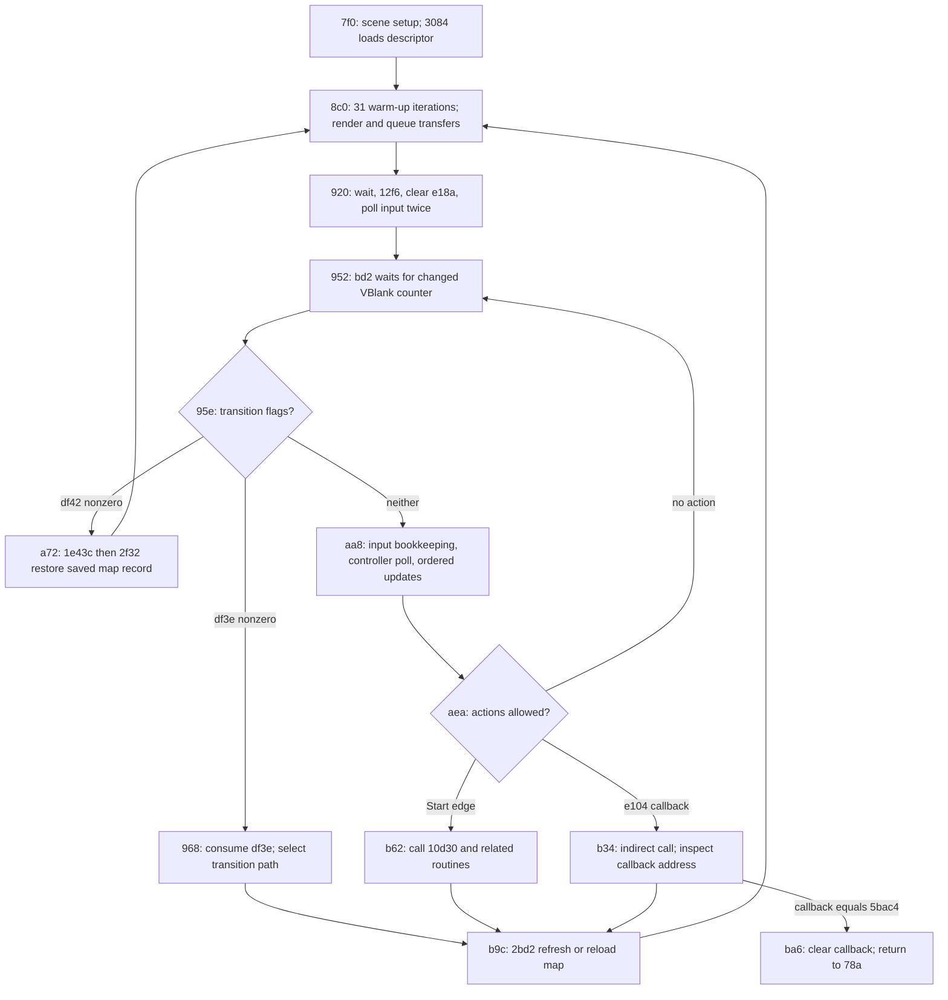

# Main loop and map loading

These are static traces of the supplied SHA-256-identified ROM, backed by saved
instruction listings and decompressor execution checks. They are not a dynamic
trace of a running game. All addresses below are hexadecimal. Unknown routine
names are deliberately left as addresses.

## Main loop

Entry path: reset → region acceptance at `6c6` → `75e` → `796` → scene setup
at `7f0` → `8c0` → interactive frame loop at `952`.



`df40` is also checked after the `df3e` path begins (`992`); when nonzero it
joins the restoration path at `a72`. It is not an independent check on every
normal frame. An `e108` test in the Start path can instead return to `7f0`.

Normal frame call order, preserving unknown meanings:

| Address | Operation |
| --- | --- |
| aa8 | `bf2`: consume previous packed input to set activity flags |
| aae | `195c`: poll controller 1, update held/pressed and heading |
| ab4 | `a8ea` |
| aba | `3a1c` |
| ac0 | `4618` |
| ac6 | `16396` |
| acc | `1dd94` |
| ad2–ae2 | Set pending-transfer bits 1, 2, 3 at `ffef14` |
| aea–b04 | Gate actions if `ffe18b`, `ffe166`, or `ffdfe8` is nonzero |
| b08–b14 | On C new-press bit, call `391a` |
| b1a–b22 | On Start new-press bit, branch to `b62` |
| b26–b42 | Otherwise, call nonzero function pointer at `ffe104` |
| b30 | Back edge to `952` |

The `BTST.B #13/#15` instructions operate modulo eight on the byte at
`ffdd22`, the *high byte* of the packed input word. They therefore test C and
Start rising edges (word bits 13 and 15). They do not read held-button bits.

Frame wait `bd2` increments word `ffdf88` once, then spins until low word
`fff9ee` of the VBlank counter differs from saved word `fff9f6`. It copies the
new word before returning. The separate `bb6` wait clears bit zero of the full
counter and compares/stores longword `fff9f4`. These saved markers overlap.
`src/frame.rs` translates these waits into host-driven, nonblocking polls;
it does not implement the update calls or replace the complete main loop.

## Descriptor loading and reload routes

| Location | Verified role |
| --- | --- |
| ffddc4 | Selected map/scene record index |
| 3232–3311 | 56 big-endian descriptor pointers; following bytes are another table |
| 3084 | Copy selected record (48 words / 96 bytes) into `ffddc6` |
| 3032 | Set `fffc0e` for indices 6–9 and 44–49; clear otherwise |
| 313a | Copy 3600 words from each layer grid to `ff2700` and `ff4700` |
| 281e/2822 | Full load path, through `3074 → 3084`, then asset/setup calls |
| 2bd2 | Fade/synchronize via `131c`; if `ffdf8e != 0`, join full load at `2822` |
| 2f32 | Restore 49 words (index + descriptor) from `ffde26` to `ffddc4`; refresh |
| 3168 | Special transition on `fffbf9 == 10`: index 0 → 3/5; 3 or other → 0 |
| 2ce0 | Indexed transition tables choose next record and spawn coordinates |

At `3168`, map 0 selects 5 when `ffddc6 >= 1400`, otherwise 3. Map 5 selects
0 with spawn data at `31f2`; other nonzero maps select 0 with spawn data at
`3202`. It writes the spawn pointer at `ffe114` and sets carry; the main loop
at `99c` uses that carry to take the reload path.

Spawn data `ffe114`, when present, is consumed at `2b78`: two words set the
camera-like fields `ffddc6/c8` (masked with `ff80`), then three coordinate pairs
are written to entity records at `ff0100`, `ff0200`, `ff0300`. The normal path
at `2b34` takes those coordinate pairs from the copied descriptor instead.
Coordinates at `ffddc6/c8` are shifted right four before map renderer indexing,
consistent with 1/16-pixel fixed-point storage. This does not establish names
for every coordinate or every descriptor field.

### Known descriptor fields

Offsets are relative to the 96-byte ROM record / RAM destination `ffddc6`.

| Offset | Size | Observed use |
| --- | --- | --- |
| 00, 02 | word each | Camera-like coordinates; shifted at `41c2` |
| 14 | long | Layer 0 block-ID grid pointer (`ffddda`) |
| 18 | long | Layer 0 tile definitions, tagged low bit (`ffddde`) |
| 1c | long | Layer 1 block-ID grid pointer (`ffdde2`) |
| 20 | long | Layer 1 tile definitions (`ffdde6`) |
| 24 | word | Grid row stride in bytes (`ffddea`), multiplied at `3fea` |
| 40 | word | Passed to `530ea`; semantic name not yet established |
| 42–4d | six words | Three entity coordinate pairs (`ffde08` through `ffde12`) |

The original grid copy always copies `1c20` bytes per layer. **That is a work
buffer copy length, not proof of map dimensions.** For example, map 0's two
source grids start only `e10` bytes apart. The extractor preserves the exact
copy and does not invent a height or assume all copied words are logical cells.

### Blocks, tile definitions, and compression

`3fd8` derives a grid byte offset and a tile-within-block byte offset:

```
grid_offset = (pixel_y >> 5) * row_stride + (pixel_x >> 5) * 2
within_block = (((pixel_y >> 3) & 3) * 4 + ((pixel_x >> 3) & 3)) * 2
```

The underlying operations wrap at 16 bits. At `3d94`, the renderer reads a
big-endian block ID from the grid, multiplies by 32, adds `within_block`, reads
a tile-attribute word from the definition table, and writes it to the VDP.
Thus a block comprises 4×4 tile-attribute words, covering 32×32 pixels.
The tile words refer to VDP graphics; they are not the pixel graphics themselves.

`29fc` tests low bit zero of the saved layer-0 definition pointer (`ffde22`).
When set, it clears the tag, calls decompressor `1610` into `ff6700`, and points
**both** layer definition pointers there. We preserve this shared-output behavior.
When clear, pointers remain ROM addresses; raw table lengths are not yet known.

Compression at `1610`:

- Big-endian initial word is decoded length minus one.
- Control bytes are consumed most-significant bit first.
- Control 0 copies one literal byte.
- Control 1 reads a command byte and a second byte.
- Command bit 7 clear: repeat the second byte `(command & 7f) + 3` times.
- Command bit 7 set: overlapping backward copy, length `(command & f) + 3`,
  distance `(second_byte << 3) | ((command >> 4) & 7)`.

Rust decoding adds bounds checks and rejects invalid distances and tokens that
exceed the declared length, rather than allowing arbitrary memory accesses.

## Validation and limits

`tools/validate_maps.py` checks all 56 native descriptors and 112 grid copies
against source ROM bytes. For all 15 compressed entries it executes the original
ROM routine in Unicorn's **M68000** CPU model, stopping at `1670`, and compares
every output byte, output length, and source consumption with the Rust extractor.
This is a routine-level CPU check, not execution of the full game.

No map has yet been assigned a place name. Logical map dimensions, tile-pixel
asset transfers, collision data, and the complete entity/script update meanings
remain unresolved. No native gameplay loop is running yet. Next: follow `1406`
and `5b7e` to identify VDP graphics/palette loading, then reconstruct one layer
with its tile definitions and verify a reference game scene.
